English · [Français](README.fr.md)

<div align="center">
  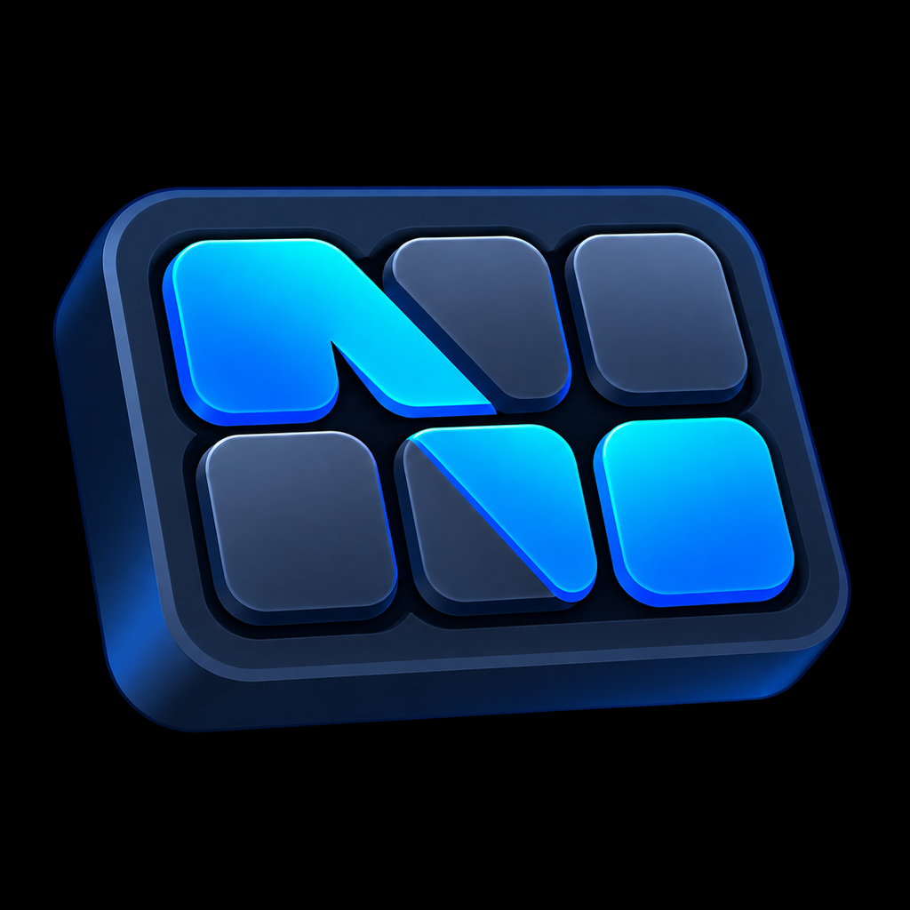
  <h1>NovyDeck</h1>
  <p>Open-source Windows software for stream decks: keys, macros, media and plugins, without the official software. Tested on the FIFINE AmpliGame D6 and the Elgato Stream Deck.</p>
  <p>
    <a href="https://github.com/HatiFlash/NovyDeck/releases/tag/v0.9.2"></a>
    <a href="LICENSE"></a>
    
  </p>
</div>

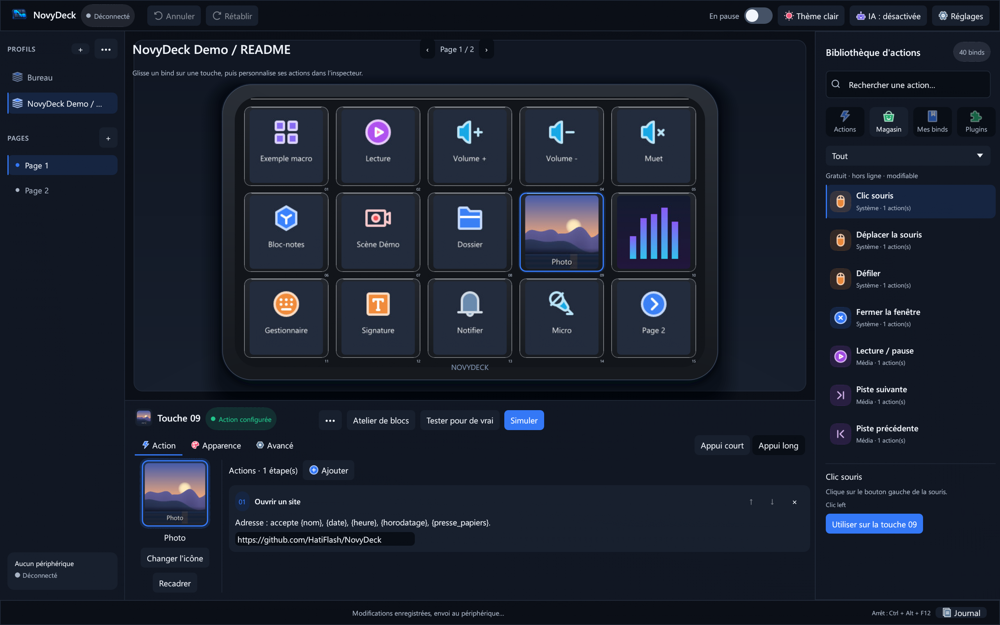

<sub>Actual interface capture rendered off-screen at 2560 × 1600 with the included “NovyDeck Demo / README” profile; no device connected.</sub>

## Presentation video

[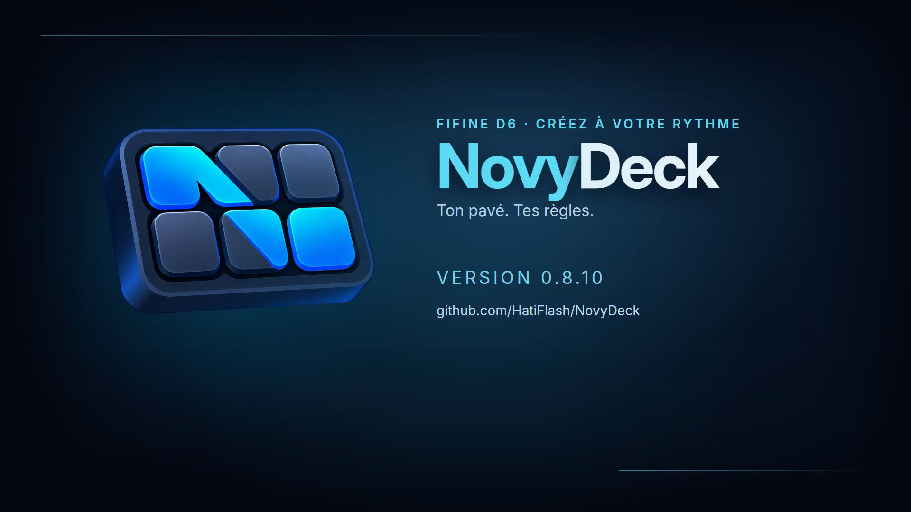](docs/media/novydeck-demo.mp4)

A 40-second presentation film in 1920 × 1080 at 60 fps with sound, made with Remotion and three.js. It features a 3D D6 deck, actual interface captures and synthesized music. The published film was produced outside this repository.

## What's new in 0.9.2

### Two images for a key: ON / OFF

Choose a key, open **Appearance → Show two key states → Switch: change on each press**, then select an image separately for **On** and **Off** using **Choose an image…** or the gallery. A short physical press alternates the two images while running the key's normal action; a configured long press does not change the image. The key starts **Off** when NovyDeck opens or when you switch pages or profiles. Existing single-image keys are unchanged.

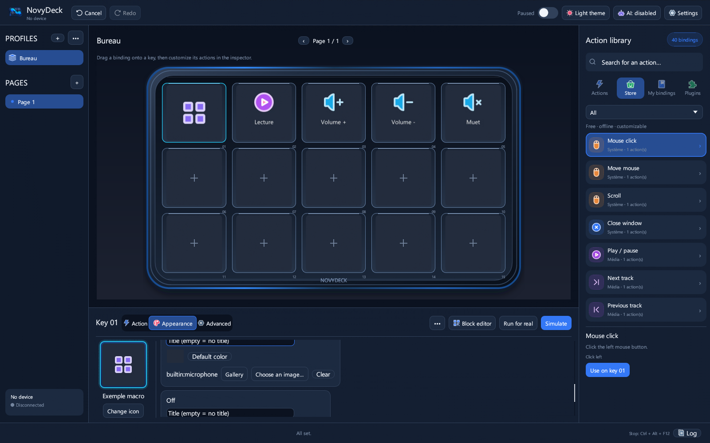

### Other fixes

The **Windows and shortcuts** dialog stays centered and cannot be dragged. The status bar, block editor title and simulation journal now respect the selected English language. Official plugins 1.0.1 remove dark boxes around key text; CPU and RAM screenshots use measurements from a Windows build runner (unavailable GPU data is still shown as unavailable).

## What's new in 0.9.0

### Plugin store

Open **Library → Plugins → Plugin store**. The store is a page of the app, like the block editor: search, filter by category, open a plugin to read its description, see its screenshots and requirements, then click **Install**. The archive is downloaded only after your confirmation and its SHA-256 fingerprint is checked before import.

| Store | Plugin page |
|---|---|
| 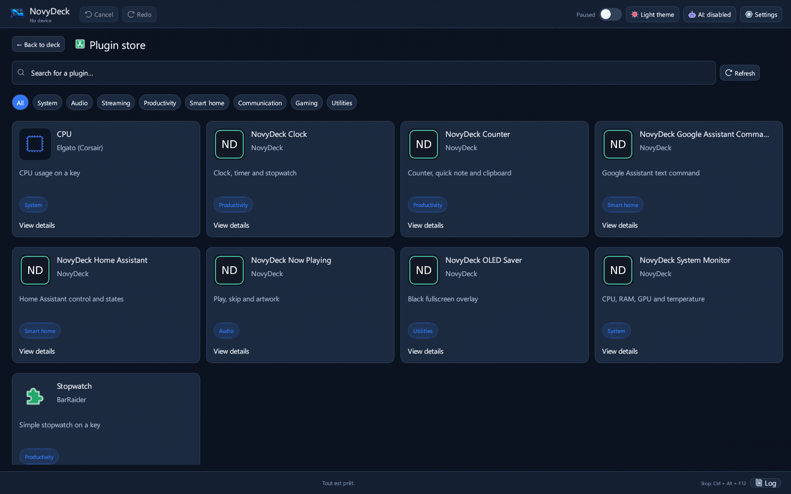 | 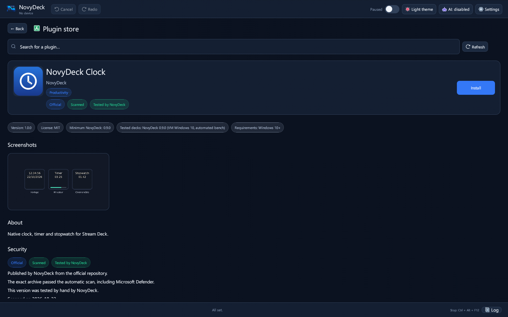 |

Available today: seven **official NovyDeck plugins** — Clock, Counter, System Monitor, Now Playing, OLED Saver, Home Assistant and **Google Assistant Command** (control your Google Home devices with a written command such as “turn on the living room light”) — plus open-source plugins tested in NovyDeck (Elgato CPU, BarRaider Stopwatch).

### Plugin actions in the block editor

The **Plugins** palette lists the actions of every installed plugin. Chain actions from **different plugins** in the same macro, with delays, conditions and any other block. The local assistant understands plugin names and never invents an action that is not installed.

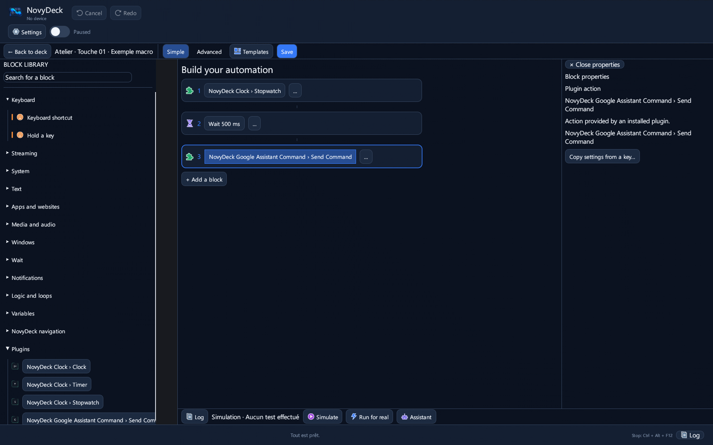

### Start minimized

When NovyDeck starts with Windows, it can now stay minimized near the clock without showing its window (option under **Start NovyDeck when Windows starts**, in **Windows and shortcuts…**).

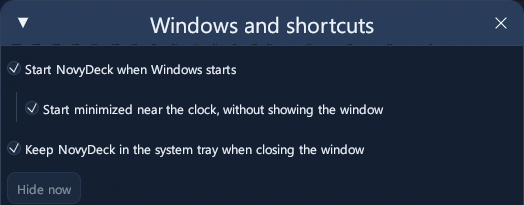

## Highlights

- **15 customizable LCD keys:** icons, colors, images, GIFs and short videos, with a preview matching the D6 display.
- **Profiles, pages and folders:** automatically switch profiles based on the foreground application.
- **Visual block editor:** build macros without scripts using shortcuts, text, applications, media, windows, conditions, loops and variables; simulate before running for real.
- **Local assistant:** turn a sentence in English or French into previewed blocks. Nothing is inserted without confirmation; optional local AI is off by default.
- **Stream Deck / OpenAction plugins:** import `.streamDeckPlugin` and `.sdPlugin` packages with isolated HTML settings ([compatibility, French](docs/PLUGINS-COMPATIBILITE.md)).
- **MCP server:** work with Claude, Codex or Cursor while approving every proposed change ([MCP guide, French](docs/MCP.md)).
- **Community plugin library:** browse and install plugins shared by the community from [novydeck-plugins](https://github.com/HatiFlash/novydeck-plugins). NovyDeck only connects after you agree, asks for confirmation and verifies each download's SHA-256; community plugins are marked as unverified.
- **Hardware report:** testing another deck brand? **Signaler un problème avec mon deck** (“Report a problem with my deck”) prepares an anonymized report (preview first) and opens a pre-filled GitHub issue; just add your deck model and what goes wrong.

## Compatibility

| Component | Status |
|---|---|
| Windows 10 and 11, 64-bit | Supported; per-user installer or portable ZIP |
| FIFINE AmpliGame D6 (15 keys) | Supported and tested; primary device |
| Elgato Stream Deck | Tested |
| Other Mirabox-based decks (Mirabox, AJAZZ / Stream Dock…) | Expected to work; not tested yet |
| Stream Deck plugins | Unencrypted plugins supported; encrypted Elgato plugins not supported |
| Local AI (llama.cpp or Ollama) | Optional; disabled by default |
| macOS, Linux | Not supported |

NovyDeck is designed to work with any stream deck. So far it has been tested on the **FIFINE AmpliGame D6** and the **Elgato Stream Deck**. Since the D6 is built on Mirabox hardware, other brands based on the same Mirabox platform should also be compatible, but they have not been tested yet — reports are welcome: use **Signaler un problème avec mon deck** (“Report a problem with my deck”) in the app, or open an [issue](https://github.com/HatiFlash/NovyDeck/issues/new?template=hardware-report.yml).

Close FIFINE Control Deck before using the D6: it holds exclusive USB access to the device.

## Quick start / installation

1. Download **`NovyDeck-0.9.2-Setup.exe`** from the [latest release](https://github.com/HatiFlash/NovyDeck/releases/latest) and run it without administrator rights, or extract `NovyDeck-0.9.2-Windows.zip`. A fresh installation uses `%LOCALAPPDATA%\Programs\NovyDeck`.
2. For updates, the installer updates an existing installation while preserving profiles, media and plugins. For a portable installation, close the app and replace the executables without deleting `config.json`, preferences, `assets` or `plugins`.
3. Launch NovyDeck from the Start menu (or the portable folder) and connect the D6. To explore without changing your profiles, choose **Profiles → ••• → Demo profile (15 keys)**. The same command resets the demo profile; you can also delete it like any other profile.
4. Drag an action from the library onto a key, or open the block editor.

## Gallery

| Block editor | Local assistant |
|---|---|
|  |  |
| Edit the selected block in the right panel. | Preview a conditional action before adding it. |

| Media cropping | Rounded key corners |
|---|---|
|  | 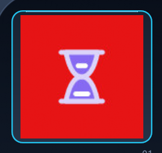 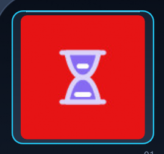 |
| Preview on the key without changing the original file. | Backgrounds now follow the shape of each key. |

| Plugin settings: Elgato | Plugin settings: VolumeController |
|---|---|
| 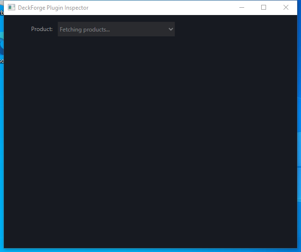 | 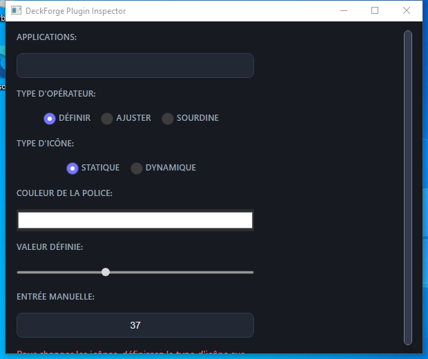 |
| 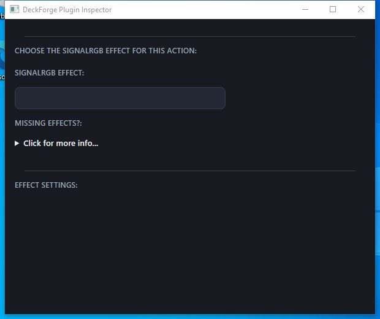 | 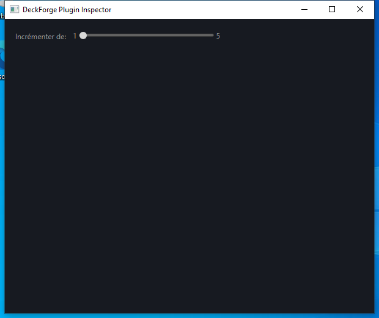 |

The plugin screenshots use UI test data, not installed user plugins.

## Features in detail

### Devices

The **FIFINE AmpliGame D6** is the primary controller, with 15 LCD keys, visual feedback, brightness control and automatic sleep. The **Elgato Stream Deck** has also been tested, using a direct HID driver with key synchronization and state feedback. Other Mirabox-based controllers (Mirabox, AJAZZ / Stream Dock…) share the D6's hardware platform and should work, but have not been tested yet.

### Visual block editor

Compose automations by dragging blocks in the interface, without AutoHotkey or scripts.

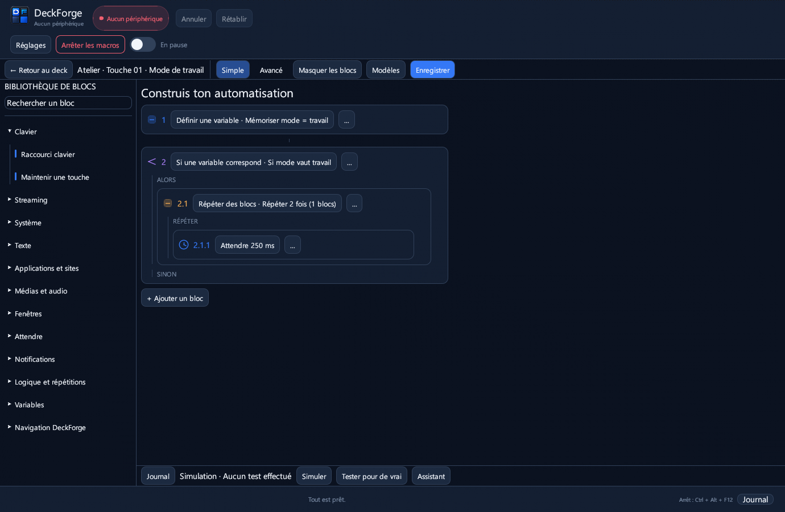

- **Audio:** adjust the foreground app or a specific executable without changing Windows master volume; switch between headset and speakers and immediately update the key icon and label.
- **Streaming and media:** control OBS Studio scenes, recording, streaming, replay buffer, sources and microphone; use Discord, the built-in soundboard and media controls.
- **Logic:** if/then/else blocks draw on 14 real-time conditions, including active window, playing audio, muted microphone, connected headset and global variables; a wait-until block is also available.
- **System and windows:** move or snap windows, bring them forward, simulate held keys with debounce and move the mouse relatively.
- **Plugin actions:** the **Plugins** palette lists the actions of every installed plugin; chain actions from different plugins in the same macro, mixed with any other block. Each plugin block keeps its own settings, and the local assistant understands plugin names (“add the stopwatch from NovyDeck Clock”) without ever inventing an action that is not installed.
- **Variables and triggers:** react to applications opening or closing, scheduled times or audio events; insert dynamic values such as `{heure}`, `{date}` and `{presse_papiers}` into messages and requests.

### Stream Deck and OpenAction plugins

Import `.streamDeckPlugin` and `.sdPlugin` packages from the built-in store, a file or a folder. In **Library → Plugins**, choose **Import this plugin** on a card, or use **Import all**.

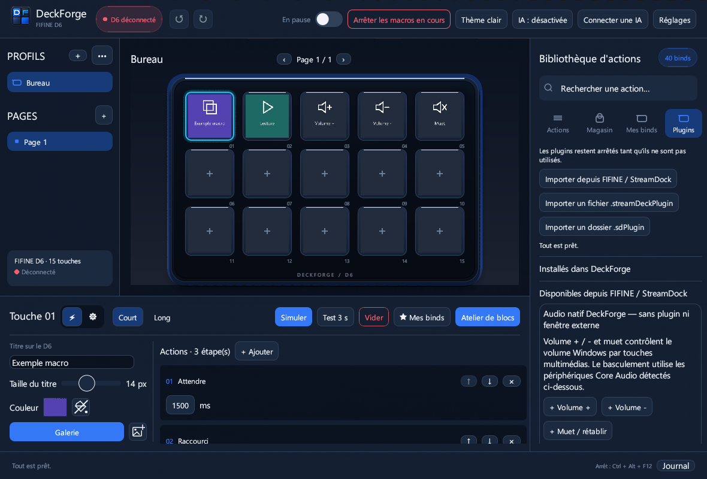

Native C++/Rust/C# executables, Node.js scripts (`@elgato/streamdeck` v2) and plugins with an HTML backend (`Runtime::Html`) are supported. HTML property inspectors run in an isolated WebView2 subprocess (`--isolated-inspector`) behind a restricted loopback proxy. Offline `sdpi-components` v3/v4 and BarRaider EasyPI are included, with dark-theme integration. Settings synchronize both ways (`setSettings`, `setGlobalSettings`) between the UI and hardware. Encrypted Elgato plugins are not supported.

### Plugin store and community library

Open **Library → Plugins** (**Bibliothèque → Plugins** in the French interface). The **Plugin store** button is first, above installed plugins. It opens a resizable window: after consenting to the GitHub connection, search or filter the community catalog, inspect descriptions and screenshots, then choose **Install** on the detail page. Installed plugins remain available in the tab below the button; local imports work offline.

1. **Installed in NovyDeck** (*Installés dans NovyDeck*): plugins already imported from a file, a folder or the built-in catalog. Drag one of their actions onto a key like any other action.
2. **Community** (*Communauté*): a public directory of plugins maintained in [HatiFlash/novydeck-plugins](https://github.com/HatiFlash/novydeck-plugins).

**Official NovyDeck plugins** (native, no Node.js required, also compatible with the Elgato software; source in [first-party/](https://github.com/HatiFlash/novydeck-plugins/tree/main/first-party)): **Clock** (clock, timer, stopwatch), **Counter** (counter, quick note, clipboard), **System Monitor** (CPU, RAM, GPU), **Now Playing** (title and cover of the current track), **OLED Saver** (black screen on the chosen monitor), **Home Assistant** (toggle entities, call services, show sensors) and **Google Assistant Command** (send a written command such as “turn on the living room light” to your Google Home devices, with your own Google Cloud project). Selected open-source plugins (Elgato CPU, BarRaider Stopwatch) are listed after being tested in NovyDeck.

How the community library works:

- NovyDeck stays offline until you click **Connect to the store**; it then downloads only the catalog (`registry.json`) from GitHub.
- Each card shows the name, version, author, license, tested decks and minimum NovyDeck version. Entries are labelled **Community — unverified**.
- **Install…** opens a confirmation with the download address and the expected SHA-256. NovyDeck downloads the archive, checks its fingerprint and only then imports it. A matching fingerprint proves the file is the one listed, not that third-party code is safe: install only plugins you trust.

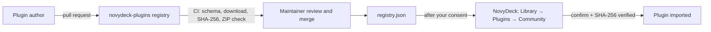

**Share your plugin:** publish a `.streamDeckPlugin` (or a `.zip` containing an `.sdPlugin` folder) at a stable HTTPS address, compute its SHA-256 (`certutil -hashfile file SHA256` on Windows), add an entry to `registry.json` following the [schema](https://github.com/HatiFlash/novydeck-plugins/blob/main/schema/registry.schema.json) and open a pull request. CI checks the entry automatically and the maintainer decides on publication. Full guide: [CONTRIBUTING.md](https://github.com/HatiFlash/novydeck-plugins/blob/main/CONTRIBUTING.md). The **Propose a plugin** button in the app opens the same page.

### Media and cropping

Crop images and videos non-destructively before sending them to a key: Fill or Fit/letterbox, 0.5×–3.0× zoom, repositioning and an immediate key preview. Windows Media Foundation decodes short videos without requiring FFmpeg; looping GIFs are supported. The gallery accepts PNG, JPEG, WebP and transparent SVG images as well as animations.

### Reliability and Elgato import

NovyDeck retains the last five healthy rotating backups (`backups/config-*.bak`) and offers guided restoration without overwriting good data with a corrupted file. Import a complete Elgato `.StreamDeckProfilesBackup` archive in one step, with automatic detection and conversion of its profiles. Macro simulation has no unsolicited system side effects.

### MCP integration

The built-in Model Context Protocol server connects to Claude Desktop, Claude Code, Codex CLI or Cursor from the AI toolbar. Assistants can inspect profiles and propose key layouts and macros; every proposed change is previewed and requires explicit approval before it is applied. No JSON configuration editing is required for the one-click connection.

### Interface and rendering

The interface uses hardware-accelerated wgpu rendering (DirectX 12 / Vulkan, with OpenGL fallback). Its key grid adapts to window size and display resolution. LCD keys can display images, looping GIFs and short videos. Profiles can be organized into folders and switched automatically when an application starts.

## Languages

The interface is available in **English** and **French**. NovyDeck follows the Windows language on first start; change it in **Settings → Language**. Each language is a single JSON file in [`res/i18n/`](res/i18n): to add yours, copy `en.json`, translate the values and open a pull request. See the [translation guide](docs/TRANSLATING.md).

## Privacy

NovyDeck works offline. Local AI stays on your PC and is optional and disabled by default; connected AI and network-enabled plugins are activated only with your explicit consent. Proposed assistant actions are previewed before insertion or application.

## Documentation

[Visual design (French)](docs/DESIGN.md) · [MCP and AI (French)](docs/MCP.md) · [Plugin architecture (French)](docs/PLUGINS-ARCHITECTURE.md) · [Plugin compatibility (French)](docs/PLUGINS-COMPATIBILITE.md) · [Elgato import (French)](docs/ELGATO.md) · [Device tests (French)](docs/TEST-PERIPHERIQUES.md) · [Media guide (French)](scripts/media/README.md)

## Latest release

- **0.9.2:** keys can alternate two user-selected ON/OFF images on short physical presses; English text and a fixed Windows and shortcuts dialog; official plugins 1.0.1 improve key text and CPU/RAM previews.
- **0.9.1:** the plugin store is now a fixed page of the app (no floating window), with a back button and Esc; plugin blocks in the block editor show readable plugin and action names; README presents the 0.9.0 features with screenshots.
- **0.9.0:** Play Store-style **plugin store** window (search, categories, detail page with screenshots, one-click install with SHA-256 check); seven official NovyDeck plugins plus tested open-source plugins; **plugin actions in the block editor**, combinable across plugins, understood by the local assistant; **start minimized** option when NovyDeck starts with Windows.
- **0.8.15:** English interface with a language selector (**Settings → Language**) and community translations as simple JSON files; optional update check at startup (asked once); release notes shown before installing an update and a **What's new** window after it.
- **0.8.14:** update from the app: **À propos → Vérifier les mises à jour** (About → Check for updates) checks the latest GitHub release; **Télécharger et installer** (Download and install) verifies the installer's SHA-256, closes NovyDeck, installs over it (profiles, media and plugins kept) and restarts it. Portable copies are pointed to the download page.
- **0.8.13:** the **Basculer l'audio** (audio switch) action can be dropped onto a key before choosing its two devices, which are then set in the inspector; previously it was rejected with “Choisis deux périphériques audio différents”.
- **0.8.12:** community plugin library (**Bibliothèque → Plugins → Communauté**), anonymized hardware report with a pre-filled GitHub issue, and the **Crop** button under the key preview is no longer cut off.
- **0.8.11:** NOVYDECK lettering on the deck chassis, with UI test coverage and updated captures and video.
- **0.8.10:** preserve the user's transparent logo across PNGs and Windows icon sizes; add reproducible resource generation and an alpha-channel regression test.

See [GitHub Releases](https://github.com/HatiFlash/NovyDeck/releases) for full release notes.

## Build from source

NovyDeck is written in Rust. Build and test with locked dependencies; building the Windows installer requires Inno Setup 6 or 7.

```bash
git clone https://github.com/HatiFlash/NovyDeck.git
cd NovyDeck
cargo build --release --locked
cargo test --locked
powershell -ExecutionPolicy Bypass -File tools\Build-Installer.ps1 -Version 0.9.2 -Build
```

## License & credits

NovyDeck is distributed under the [MIT license](LICENSE). The source repository does not include proprietary third-party binaries, protected archives or closed resource packs. Interface icons come from [IconPark](https://github.com/bytedance/IconPark) (ByteDance), licensed under Apache 2.0; only the icons in use are bundled and recolored for NovyDeck ([notice](res/iconpark/NOTICE.md), [license](res/iconpark/LICENSE)). See [THIRD-PARTY-NOTICES.txt](THIRD-PARTY-NOTICES.txt) for notices covering open-source dependencies and bundled libraries.
