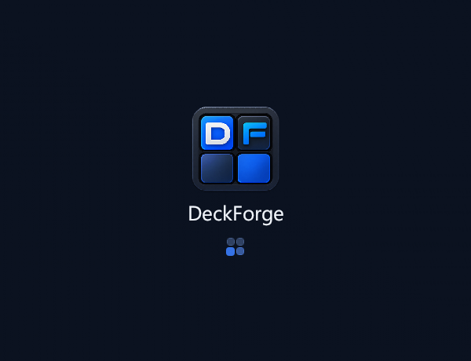
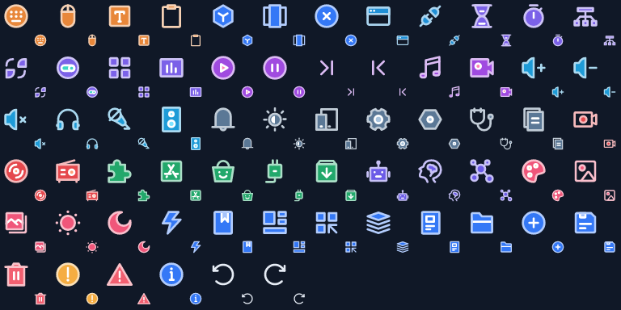
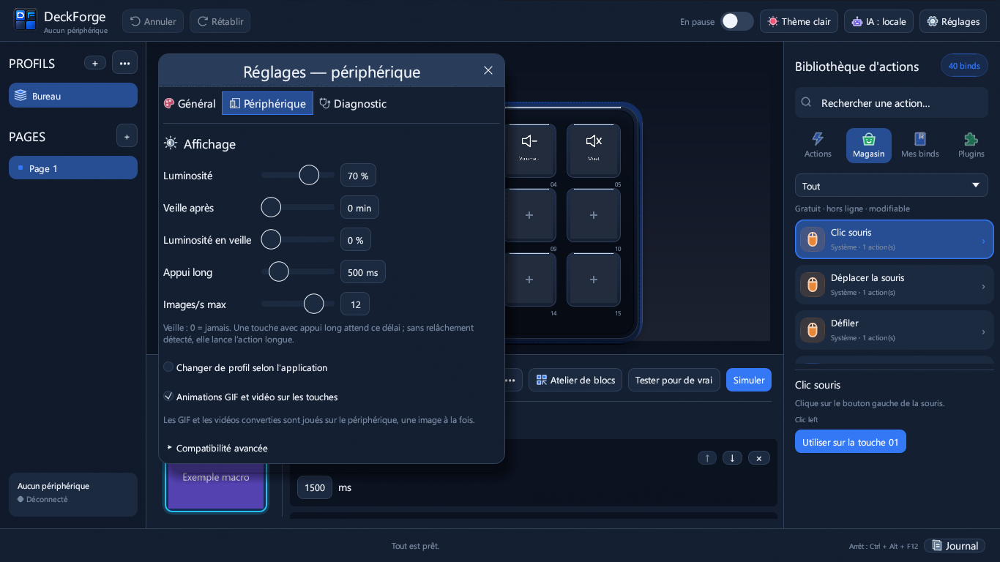
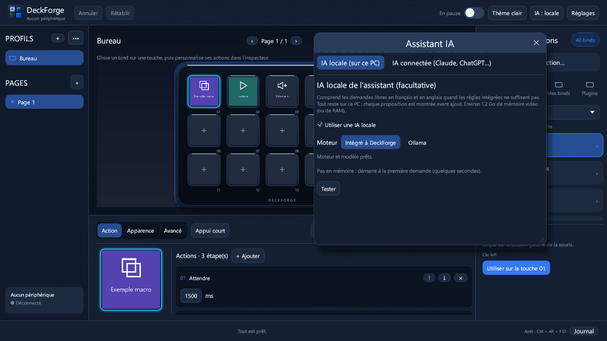
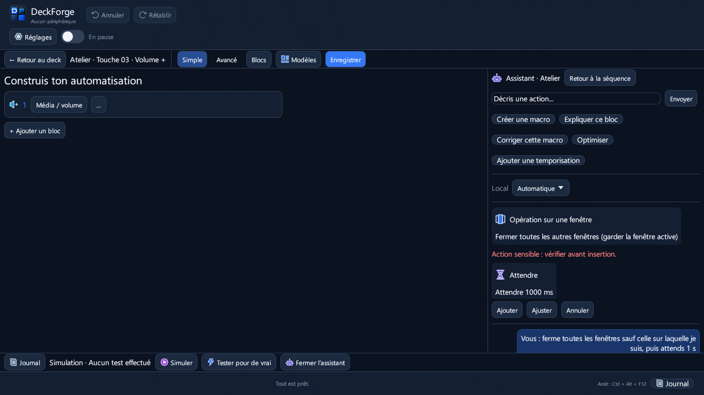

# DeckForge

<div align="center">
  <br>
  <h3>Le centre de contrôle macro & streamdeck open-source, ultra-rapide et sécurisé pour Windows</h3>

  [](LICENSE)
  [](https://www.rust-lang.org/)
  []()
  [](https://github.com/HatiFlash/DeckForge/releases/tag/v0.8.4)
</div>

---

**DeckForge** est une application indépendante écrite en **Rust** (egui + wgpu DirectX 12 / Vulkan) conçue pour piloter vos claviers macro physiques avec un niveau de performance, de personnalisation et de sécurité inégalé. Fini les logiciels propriétaires lourds et fermés : DeckForge vous offre une réactivité instantanée, un atelier d'automatisation visuel complet sans dépendance externe, un connecteur IA (MCP) natif et la compatibilité avec l'écosystème de plugins Elgato Stream Deck.


---

## 🆕 Nouveautés 0.8.4

- **Icônes multi-couleurs IconPark** dans toute l'interface, une couleur par famille d'actions (clavier, applications, web, logique, médias, audio, système, OBS, plugins, IA, images), lisibles en thème sombre comme en clair. Seuls les 66 pictogrammes utilisés sont embarqués ; le rendu des touches du périphérique ne change pas.
- **Animations** : intro au démarrage, indicateur de chargement DeckForge pendant les attentes, point « En attente » animé pendant la connexion, fondus au changement de page, de profil et d'onglet. Réglage « Réduire les animations » dans Réglages → Général.
- Correction : les boutons de l'inspecteur ne recouvrent plus « Appui court » sur petit écran. Détails : [docs/RELEASE-0.8.4.md](docs/RELEASE-0.8.4.md).

| Démarrage | Icônes de l'interface |
|---|---|
|  |  |

## Nouveautés 0.8.3

- **Interface allégée** : un seul bouton « Assistant IA » (IA locale et IA connectée dans la même fenêtre, à onglets), « Arrêter les macros » visible seulement pendant une exécution, plus de badge rouge « Aucun périphérique » en double.
- **Réglages en onglets** (Général, Périphérique, Diagnostic) : tiennent sur un écran de portable, valeurs avec unités.
- **« Simuler » / « Tester pour de vrai »** : la différence est explicite partout.
- **IA locale plus sûre** : mémoire libérée après 10 min sans demande, repli automatique sur le processeur, installation annulable et reprise, vérification de l'espace disque, bouton « Demander plutôt à l'IA locale ». Assistant complet : 28/30 (intégré) et 29/30 (Ollama) sur le banc de 30 demandes libres. Détails : [docs/RELEASE-0.8.3.md](docs/RELEASE-0.8.3.md).



## Nouveautés 0.8.2

- **IA locale facultative pour l'assistant de l'atelier** (désactivée par défaut) : comprend les demandes libres en français et en anglais quand les règles intégrées ne suffisent pas (« garde cette fenêtre toujours au-dessus », « rappelle-moi de boire de l'eau »…). Tout reste sur le PC, chaque proposition est montrée en aperçu et rien n'est inséré sans validation.
- **Deux moteurs** (bouton « IA : … » de la barre supérieure → IA locale) : moteur **intégré** installé en un clic (llama.cpp + Qwen2.5 1,5B, ≈1,2 Go, empreintes SHA-256 vérifiées) ou **Ollama** déjà installé (`ollama pull qwen2.5:1.5b`).
- Mesuré sur 30 demandes libres, processeur seul : 26/30 (intégré) et 27/30 (Ollama) suites de blocs exactes, en 1 à 2 s. Détails : [docs/RELEASE-0.8.2.md](docs/RELEASE-0.8.2.md).



## Nouveautés 0.8.1

- **Installateur Windows** (`DeckForge-0.8.1-Setup.exe`) : sans droits administrateur, raccourcis menu Démarrer / Bureau, désinstallation propre ; profils, préférences, icônes et plugins conservés.
- **Onglet Plugins corrigé** : plus de gel ni de rafale de fenêtres console à l'ouverture.
- **Exécutable mieux identifié par Windows** : icône, informations de version et manifeste intégrés (moins de faux positifs Defender ; l'exécutable n'est pas encore signé).
- **Thèmes** : thème clair refait, styles Bleu nuit, Graphite, Clair et Sable, cinq couleurs d'accent (Réglages → Thème de l'interface).
- **Assistant de l'atelier plus naturel**, en français et en anglais : « ferme toutes les fenêtres sauf celle sur laquelle je suis », « réduis les autres fenêtres », « affiche le bureau », « wait 2 seconds then open https://… ». Nouveaux blocs *Fermer / Réduire les autres fenêtres*.
- **Galerie** : bouton « Importer une icône… » ; **aperçu** des touches corrigé (images en portrait cadrées vers le haut, titre lisible) et bouton « Recadrer ».



---

## ✨ Fonctionnalités phares

### 🎮 Périphériques pris en charge
- **FIFINE AmpliGame D6 (15 touches LCD)** : Prise en charge matérielle complète, retour visuel dynamique sur chaque touche, réglage de la luminosité et mise en veille automatique.
- **Elgato Stream Deck (Testé & Compatible)** : Prise en charge native via le pilote HID direct pour les claviers Stream Deck physiques, avec synchronisation des touches et retour d'état en direct.
- **Contrôleurs compatibles HID** : Architecture modulaire extensible pour d'autres modèles du marché (Mirabox, AJAZZ / Stream Dock).

### ⚡ Atelier de blocs natif (Sans scripts ni dépendance)
Composez des automatisations puissantes en glissant-déposant des blocs directement dans l'interface, sans avoir besoin d'AutoHotkey :


- **Gestion audio intelligente** : Ajustez le volume de l'application au premier plan ou d'un exécutable précis sans jamais altérer le volume général de Windows. Basculez d'un clic entre casque et enceintes avec mise à jour immédiate de l'icône et du titre sur la touche.
- **Intégrations streaming & multimédia** : Contrôle natif d'OBS Studio (changement de scènes, enregistrement, stream, replay buffer, bascule des sources et micro), Discord, soundboard intégrée et commandes multimédias.
- **Logique conditionnelle avancée** : Blocs *Si... alors... sinon* basés sur 14 conditions en temps réel (fenêtre active, son en cours de lecture, micro muet, casque branché, variables globales) et bloc *Attendre que...*.
- **Contrôle système & fenêtres** : Déplacement de fenêtres vers un second écran, ancrage, premier plan forcé, simulation fluide de frappes clavier (maintien de touche, anti-rebond) et déplacements relatifs de souris.
- **Variables & Déclencheurs automatiques** : Déclenchez des actions lors de l'ouverture/fermeture d'un jeu ou logiciel, à heure fixe ou sur événement audio. Insérez des variables dynamiques `{heure}`, `{date}`, `{presse_papiers}` dans vos messages et requêtes.

### 🧩 Écosystème de Plugins Stream Deck & OpenAction
Importez directement vos archives de plugins préférées (`.streamDeckPlugin` / `.sdPlugin`) depuis le magasin intégré :


- **Multi-moteurs d'exécution** : Prise en charge des exécutables natifs C++/Rust/C#, des scripts Node.js (`@elgato/streamdeck` v2) et des plugins avec moteur backend HTML (`Runtime::Html`).
- **Property Inspectors HTML sécurisés** : Les fenêtres de réglages s'exécutent dans un sous-processus WebView2 isolé (`--isolated-inspector`) avec proxy loopback strict interdisant toute fuite réseau non autorisée (anti-TOCTOU, pas d'accès internet sauvage).
- **Composants sdpi intégrés hors-ligne** : Support natif des `sdpi-components` officiels v3 et v4 (embarqués localement) et BarRaider EasyPI avec injection automatique du thème sombre.
- **Persistance bidirectionnelle** : Synchronisation temps réel des réglages (`setSettings`, `setGlobalSettings`) entre l'interface et le matériel.

<div align="center">

| Property Inspector Elgato (sdpi-components) | Réglages VolumeController (BarRaider) |
| :---: | :---: |
|  |  |
| **SignalRGB (EasyPI + thème DeckForge)** | **Compteur Elgato (Node.js)** |
|  |  |

</div>

### 🎨 Éditeur de recadrage interactif intégré & Galerie multimédia
- **Recadrage non destructif des images et vidéos** : Ajustez visuellement vos photos et vidéos directement dans DeckForge avant envoi aux touches (modes Remplir ou Ajuster/Letterbox, zoom progressif 0.5x–3.0x, recentrage et prévisualisation instantanée du rendu fidèle sur touche D6 112x112 px).
- **Décodage vidéo Media Foundation Windows & GIF infinis** : Import direct sans FFmpeg requis pour vos clips courts et animations en boucle.
- **Galerie multimédia riche** : Prise en charge complète des images PNG, JPEG, WebP, SVG transparents et animations.

### 🛡️ Fiabilité, Sauvegardes rotatives & Import Elgato 1-Clic
- **Sauvegardes automatiques rotatives & restauration guidée** : Rétention des 5 derniers points de restauration sains (`backups/config-*.bak`) avec protection stricte contre l'écrasement par un fichier corrompu.
- **Import 1-clic des sauvegardes Elgato (`.StreamDeckProfilesBackup`)** : Détection et conversion automatique de tous les profils d'une archive complète sans décompression manuelle.
- **Simulation sécurisée & isolée** : Mode test de macros sans aucun effet système de bord non sollicité.

### 🤖 Intégration IA Plug-and-Play (Protocole MCP)
DeckForge embarque un serveur MCP (**Model Context Protocol**) natif pour collaborer avec vos assistants d'IA sans aucune ligne de code ni modification de fichier JSON :
- Connectez d'un clic **Claude Desktop**, **Claude Code**, **Codex CLI** ou **Cursor** via le bouton **IA** dans la barre d'outils.
- L'IA peut explorer vos profils, vous suggérer des agencements de touches optimisés pour vos jeux ou outils de création, et générer des macros complètes.
- **Contrôle humain préservé** : chaque proposition d'action formulée par l'IA apparaît en prévisualisation et attend votre validation explicite avant d'être appliquée sur votre profil.

### 🎨 Interface Studio & Rendu Direct wgpu
- **Rendu matériel wgpu (DirectX 12 / Vulkan)** : Finis les scintillements et artefacts d'affichage rencontrés sur d'autres outils egui ; l'interface est parfaitement fluide à 60+ FPS.
- **Pavé dynamique réactif** : La grille de touches s'adapte automatiquement à la résolution de votre écran et aux redimensionnements de la fenêtre.
- **Galerie multimédia riche** : Prise en charge complète des images PNG, JPEG, SVG transparents, mais aussi des GIF animés et des vidéos courtes lues en boucle directement sur les touches LCD.
- **Gestion multi-profils et dossiers** : Créez des profils dédiés par application avec basculement automatique au lancement de vos jeux ou logiciels créatifs, et organisez vos touches en sous-dossiers infinis.

---

## 🚀 Prise en main rapide

1. Téléchargez **`DeckForge-0.8.4-Setup.exe`** depuis la [page des Releases](https://github.com/HatiFlash/DeckForge/releases) et lancez-le (aucun droit administrateur requis). DeckForge s'installe dans `%LOCALAPPDATA%\Programs\DeckForge` avec un raccourci dans le menu Démarrer.
   - Version portable : `DeckForge-0.8.4-Windows.zip`, à extraire dans le dossier de votre choix.
   - Vous utilisiez déjà la version portable ? Copiez `config.json`, `preferences.json`, `variables.json` et les dossiers `assets` et `plugins` de l'ancien dossier vers le dossier d'installation, DeckForge fermé.
2. Lancez DeckForge depuis le menu Démarrer.
3. *Note importante pour les possesseurs du FIFINE D6 :* veillez à fermer le logiciel officiel FIFINE afin de libérer l'accès USB exclusif pour DeckForge.
4. Glissez simplement une action depuis la bibliothèque vers la touche souhaitée, ou ouvrez l'**Atelier de blocs** pour composer votre première macro !

---

## 🛠️ Compilation & Développement

DeckForge est développé en Rust et se compile en mode verrouillé (`--locked`) :

```bash
# Cloner le dépôt
git clone https://github.com/HatiFlash/DeckForge.git
cd DeckForge

# Compiler en mode Release
cargo build --release --locked

# Lancer la suite complète de tests (360 tests unitaires et d'intégration)
cargo test --locked

# Construire l'installateur (Inno Setup 6 ou 7 requis)
powershell -ExecutionPolicy Bypass -File tools\Build-Installer.ps1 -Version 0.8.4 -Build
```

---

## 📄 Licence & Mentions

Ce projet est distribué sous [licence MIT](LICENSE). Aucun binaire tiers propriétaire, archive protégée ou pack de ressources fermé n'est inclus dans le dépôt de code source.

Les icônes d'interface proviennent d'[IconPark](https://github.com/bytedance/IconPark) (ByteDance), sous licence Apache 2.0 : seuls les pictogrammes utilisés sont embarqués, recolorés selon la palette de DeckForge (voir [res/iconpark/NOTICE.md](res/iconpark/NOTICE.md) et [res/iconpark/LICENSE](res/iconpark/LICENSE)). La licence est aussi consultable dans « À propos de DeckForge ».
Pour les notices relatives aux dépendances open-source et bibliothèques embarquées, consultez [THIRD-PARTY-NOTICES.txt](THIRD-PARTY-NOTICES.txt).
