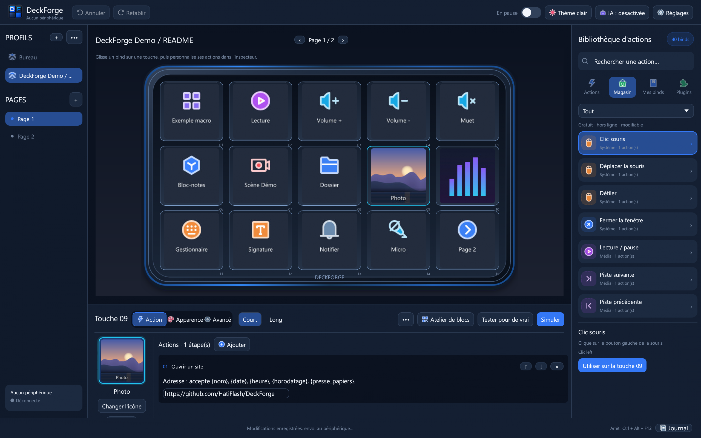
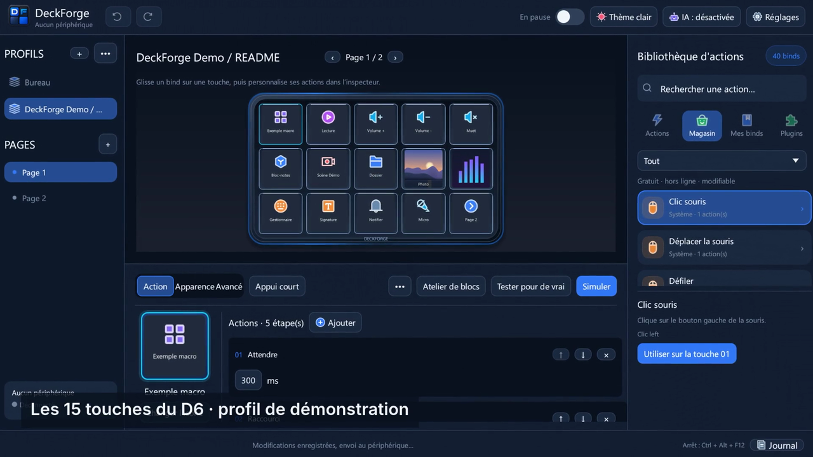
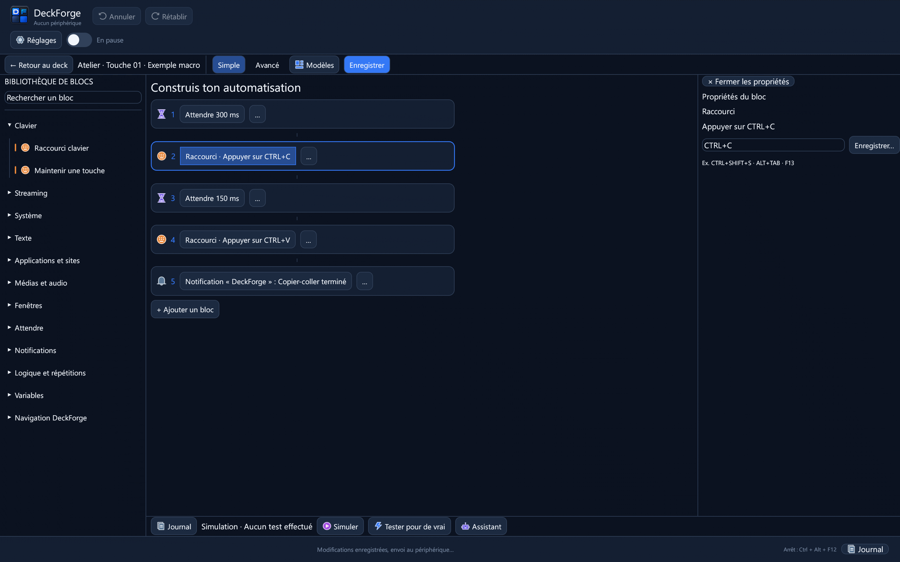
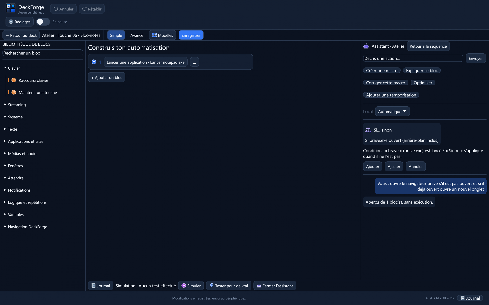
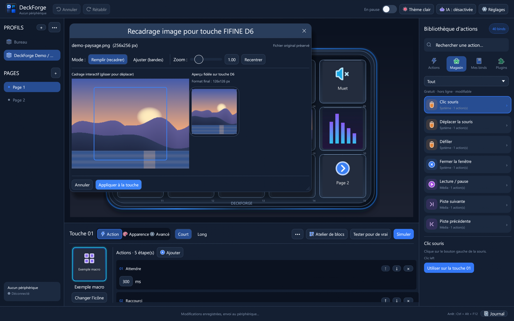
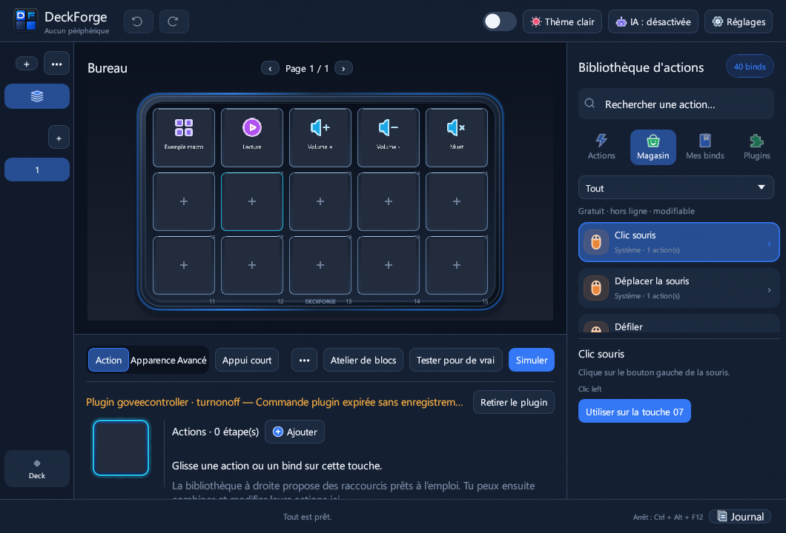
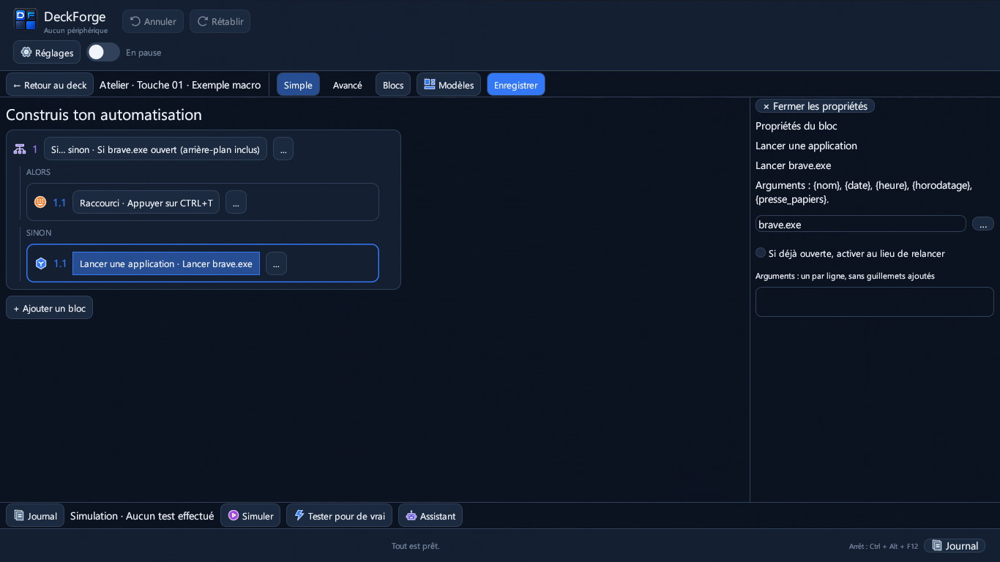
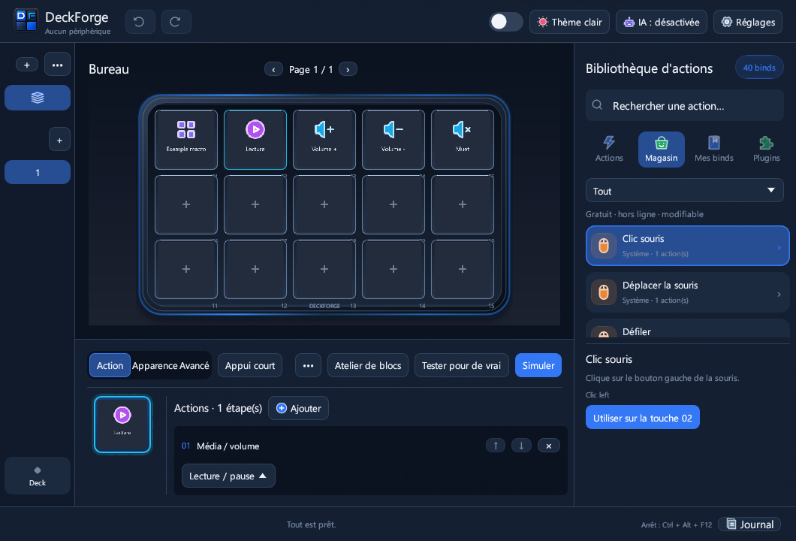
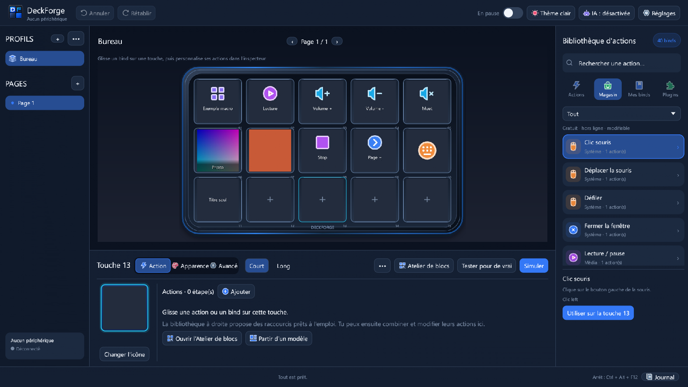
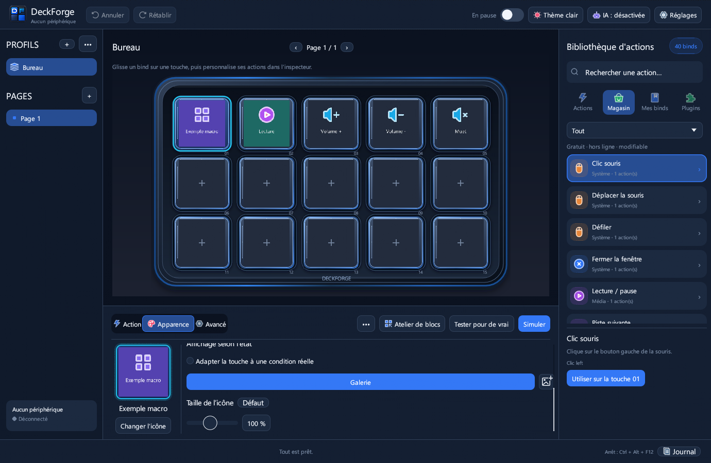

# DeckForge

<div align="center">
  <br>
  <strong>Logiciel libre pour Windows qui pilote le pavé FIFINE AmpliGame D6 : touches, macros, médias et plugins, sans le logiciel officiel.</strong>
  <br><br>

  [](https://github.com/HatiFlash/DeckForge/releases/tag/v0.8.8)
  [](LICENSE)
</div>



<sub>Capture réelle de l'interface (rendu hors écran à 2560 × 1600, profil « DeckForge Demo / README » fourni avec l'application, aucun périphérique connecté).</sub>

## Vidéo de présentation

[](docs/media/deckforge-demo.mp4)

30 secondes, 1920 × 1080, sans son : profil, pages, atelier de blocs, assistant et recadrage. Les images proviennent de l'interface réelle ([procédure](scripts/media/README.md)).

## Points clés

- **15 touches personnalisées** : icônes, couleurs, images, GIF et vidéos courtes, avec un aperçu identique à l'écran du D6.
- **Profils, pages et dossiers**, avec changement automatique de profil selon l'application au premier plan.
- **Atelier de blocs** : macros sans script (raccourcis, texte, applications, médias, fenêtres, conditions, répétitions, variables), simulation avant exécution réelle.
- **Assistant local** : une phrase en français ou en anglais devient des blocs, montrés en aperçu ; rien n'est inséré sans validation. IA locale facultative, désactivée par défaut.
- **Plugins Stream Deck / OpenAction** : import de `.streamDeckPlugin` et `.sdPlugin`, réglages HTML isolés ([compatibilité](docs/PLUGINS-COMPATIBILITE.md)).
- **Serveur MCP** pour Claude, Codex ou Cursor, avec validation humaine de chaque modification ([MCP](docs/MCP.md)).

## Compatibilité

| Élément | État |
|---|---|
| Windows 10 et 11, 64 bits | Disponible (installateur sans droits administrateur, ou ZIP portable) |
| FIFINE AmpliGame D6 (15 touches) | Disponible, périphérique principal du projet |
| Elgato Stream Deck, Mirabox, AJAZZ / Stream Dock | Expérimental |
| Plugins Stream Deck | Disponible pour les plugins non chiffrés ; plugins Elgato chiffrés non pris en charge |
| IA locale (llama.cpp ou Ollama) | Facultatif, désactivé par défaut |
| macOS, Linux | Non pris en charge |

Fermez le logiciel officiel FIFINE Control Deck : il garde l'accès USB exclusif au D6.

## Installation rapide

1. Téléchargez **`DeckForge-0.8.8-Setup.exe`** depuis la [dernière release](https://github.com/HatiFlash/DeckForge/releases/latest) et lancez-le (aucun droit administrateur requis), ou extrayez `DeckForge-0.8.8-Windows.zip`.
   - Vous utilisiez la version portable ? DeckForge fermé, copiez `config.json`, `preferences.json`, `variables.json` et les dossiers `assets` et `plugins` vers `%LOCALAPPDATA%\Programs\DeckForge`.
2. Lancez DeckForge depuis le menu Démarrer et branchez le D6.
3. Pour découvrir l'application sans toucher à vos profils : **Profils → ••• → Profil de démonstration (15 touches)**. Ce profil se réinitialise par la même commande et peut être supprimé comme un autre.
4. Glissez une action de la bibliothèque sur une touche, ou ouvrez l'**Atelier de blocs**.

## Galerie

| Atelier de blocs | Assistant local |
|---|---|
|  |  |
| Macro de démonstration en cinq blocs ; le panneau de droite règle le bloc choisi. | Réponse réelle des règles locales : condition « Brave ouvert ? », aperçu avant ajout. |

| Recadrage d'image | Coins des touches (0.8.8) |
|---|---|
|  |   |
| Aperçu fidèle sur la touche ; le fichier d'origine est conservé. | Avant / après : le fond suit désormais l'arrondi de la touche. |

## Documentation

[Identité visuelle](docs/DESIGN.md) · [MCP et IA](docs/MCP.md) · [Plugins : architecture](docs/PLUGINS-ARCHITECTURE.md) et [compatibilité](docs/PLUGINS-COMPATIBILITE.md) · [Import Elgato](docs/ELGATO.md) · [Tests périphériques](docs/TEST-PERIPHERIQUES.md) · [Médias de présentation](scripts/media/README.md)

**Confidentialité :** tout fonctionne hors ligne. L'IA locale reste sur le PC ; l'IA connectée et les plugins réseau ne s'activent qu'avec votre accord explicite.

## Historique des versions

### Nouveautés 0.8.8

- **Coins des touches corrigés** : fonds, images, GIF et vidéos sont masqués à l'arrondi de l'écran de chaque touche (grille et inspecteur), net jusqu'à 200 %. L'image envoyée au D6 ne change pas.
- **Profil de démonstration** « DeckForge Demo / README » : 15 touches remplies avec des actions existantes et des médias générés par l'application, ajouté sans modifier vos profils.
- **README et identité visuelle** : captures réelles en 2560 × 1600, vidéo de présentation reproductible, jetons de design documentés ([DESIGN.md](docs/DESIGN.md)).
- Correction : dans les propriétés d'un raccourci clavier, le bouton « Enregistrer… » n'est plus coupé par un panneau étroit. Détails : [docs/RELEASE-0.8.8.md](docs/RELEASE-0.8.8.md).

### Nouveautés 0.8.7

- **Inspecteur des touches plugin** : « Réglages du plugin » et « Retirer le plugin » restent visibles ; l'identifiant long du plugin est raccourci à gauche (nom complet au survol).
- **Atelier de blocs, mode Simple** : cliquer sur un bloc, y compris dans ALORS / SINON, ouvre toujours ses propriétés modifiables, même en fenêtre compacte quand la bibliothèque ou l'assistant était ouvert.
- **Assistant (règles + IA locale)** : « ouvre Brave s'il n'est pas ouvert, et s'il est déjà ouvert ouvre un nouvel onglet » donne une vraie condition (onglet si Brave tourne, lancement sinon). Nouveaux raccourcis reconnus : rouvrir l'onglet fermé, onglet suivant/précédent, plein écran.
- **Activation d'une application déjà ouverte** plus fiable depuis une touche du D6 (contournement documenté du verrou de premier plan de Windows, court délai avant le raccourci). Windows peut encore refuser : l'erreur reste affichée, jamais un faux succès.
- **Consommation de RAM** : backport du correctif officiel egui #7928. Quand une image du rendu graphique (WGPU) est abandonnée, ses tampons de transfert, alloués en RAM système, n'étaient pas libérés et s'accumulaient. Défaut réel reproduit en banc (mémoire privée du processus passée d'environ 4,6 à 7,2 Go en quelques secondes sans correctif, stable avec) ; la pointe de 35 Go observée sur un PC n'est pas démontrée comme venant de ce défaut. Voir [les notes de la 0.8.7](docs/RELEASE-0.8.7.md).

| Touche plugin (1060 px) | Atelier Simple : propriétés d'un bloc imbriqué |
|---|---|
|  |  |

*Captures du banc d'interface sans D6 ; le plugin Govee affiché est une donnée de test, pas un plugin installé.*

### Nouveautés 0.8.6

- **Châssis 3D sans touches pré-dessinées** : le SVG ne dessine que le boîtier. Les 15 touches interactives egui remplissent mieux l'intérieur (faces 228 × 214 au lieu de 202 × 190 en coordonnées SVG), avec des marges et écarts réduits, un relief léger et un seul contour. La grille et le boîtier partagent le même repère et s'adaptent sans déformation à la fenêtre et au DPI.
- Les exemples d'origine « Exemple macro » et « Lecture » utilisent désormais le fond neutre des autres touches, sans aplats violet/vert. Les profils déjà personnalisés, leurs images, GIF, vidéos et actions ne sont pas remplacés ; les nouvelles couleurs concernent les profils créés avec les valeurs d'origine.
- Vérifié sur le banc Windows : 374 tests réussis (18 ignorés), captures à 1060 × 720, 1380 × 900 et 1920 × 1080 à 125 % de DPI. Voir [les notes de la 0.8.6](docs/RELEASE-0.8.6.md).

| Fenêtre compacte (1060 × 720) | HiDPI et médias d'essai (1920 × 1080, 125 %) |
|---|---|
|  |  |

*Captures de l'interface en banc VM, sans FIFINE D6 connecté. La vue HiDPI contient des médias de test, pas des images ou profils de l'utilisateur.*

### Nouveautés 0.8.5

- **Bibliothèque → Plugins** : le panneau défile sur toute sa hauteur, les cartes sont lisibles sur petite fenêtre, le bouton « Importer ce plugin » reste sous chaque plugin ; les détails longs sont repliés et l'audio natif reste accessible dans une section dédiée.
- **Inspecteur de touche** : l'aperçu et « Changer l'icône » restent fixes à gauche ; seul le formulaire de propriétés défile à droite.
- **Pavé FIFINE D6** : châssis SVG redimensionnable à 15 touches (5 × 3), icônes par défaut IconPark et onglets arrondis. Les médias personnalisés des touches ne sont pas remplacés.
- **Assistant local facultatif** : connaissances configurables dans `res/ia/ia-locale.json`, demandes conditionnelles et répétitives avec aperçu préalable ; aucune action n'est exécutée automatiquement. Voir [notes de la 0.8.5](docs/RELEASE-0.8.5.md).

| Importation de plugins | Défilement de l'inspecteur |
|---|---|
|  |  |

*Captures du banc d’interface, sans périphérique connecté ; la carte de plugin utilise un exemple de test, pas un plugin installé.*

### Nouveautés 0.8.4

- **Icônes multi-couleurs IconPark** dans toute l'interface, une couleur par famille d'actions (clavier, applications, web, logique, médias, audio, système, OBS, plugins, IA, images), lisibles en thème sombre comme en clair. Seuls les 66 pictogrammes utilisés sont embarqués ; le rendu des touches du périphérique ne change pas.
- **Animations** : intro au démarrage, indicateur de chargement DeckForge pendant les attentes, point « En attente » animé pendant la connexion, fondus au changement de page, de profil et d'onglet. Réglage « Réduire les animations » dans Réglages → Général.
- Correction : les boutons de l'inspecteur ne recouvrent plus « Appui court » sur petit écran. Détails : [docs/RELEASE-0.8.4.md](docs/RELEASE-0.8.4.md).

| Démarrage | Icônes de l'interface |
|---|---|
|  |  |

### Nouveautés 0.8.3

- **Interface allégée** : un seul bouton « Assistant IA » (IA locale et IA connectée dans la même fenêtre, à onglets), « Arrêter les macros » visible seulement pendant une exécution, plus de badge rouge « Aucun périphérique » en double.
- **Réglages en onglets** (Général, Périphérique, Diagnostic) : tiennent sur un écran de portable, valeurs avec unités.
- **« Simuler » / « Tester pour de vrai »** : la différence est explicite partout.
- **IA locale plus sûre** : mémoire libérée après 10 min sans demande, repli automatique sur le processeur, installation annulable et reprise, vérification de l'espace disque, bouton « Demander plutôt à l'IA locale ». Assistant complet : 28/30 (intégré) et 29/30 (Ollama) sur le banc de 30 demandes libres. Détails : [docs/RELEASE-0.8.3.md](docs/RELEASE-0.8.3.md).


### Nouveautés 0.8.2

- **IA locale facultative pour l'assistant de l'atelier** (désactivée par défaut) : comprend les demandes libres en français et en anglais quand les règles intégrées ne suffisent pas (« garde cette fenêtre toujours au-dessus », « rappelle-moi de boire de l'eau »…). Tout reste sur le PC, chaque proposition est montrée en aperçu et rien n'est inséré sans validation.
- **Deux moteurs** (bouton « IA : … » de la barre supérieure → IA locale) : moteur **intégré** installé en un clic (llama.cpp + Qwen2.5 1,5B, ≈1,2 Go, empreintes SHA-256 vérifiées) ou **Ollama** déjà installé (`ollama pull qwen2.5:1.5b`).
- Mesuré sur 30 demandes libres, processeur seul : 26/30 (intégré) et 27/30 (Ollama) suites de blocs exactes, en 1 à 2 s. Détails : [docs/RELEASE-0.8.2.md](docs/RELEASE-0.8.2.md).


### Nouveautés 0.8.1

- **Installateur Windows** (`DeckForge-0.8.1-Setup.exe`) : sans droits administrateur, raccourcis menu Démarrer / Bureau, désinstallation propre ; profils, préférences, icônes et plugins conservés.
- **Onglet Plugins corrigé** : plus de gel ni de rafale de fenêtres console à l'ouverture.
- **Exécutable mieux identifié par Windows** : icône, informations de version et manifeste intégrés (moins de faux positifs Defender ; l'exécutable n'est pas encore signé).
- **Thèmes** : thème clair refait, styles Bleu nuit, Graphite, Clair et Sable, cinq couleurs d'accent (Réglages → Thème de l'interface).
- **Assistant de l'atelier plus naturel**, en français et en anglais : « ferme toutes les fenêtres sauf celle sur laquelle je suis », « réduis les autres fenêtres », « affiche le bureau », « wait 2 seconds then open https://… ». Nouveaux blocs *Fermer / Réduire les autres fenêtres*.
- **Galerie** : bouton « Importer une icône… » ; **aperçu** des touches corrigé (images en portrait cadrées vers le haut, titre lisible) et bouton « Recadrer ».


---

## Fonctionnalités en détail

### 🎮 Périphériques pris en charge
- **FIFINE AmpliGame D6 (15 touches LCD)** : périphérique principal, utilisé au quotidien ; retour visuel sur chaque touche, luminosité et mise en veille automatique.
- **Elgato Stream Deck** (expérimental) : pilote HID direct, synchronisation des touches et retour d'état.
- **Autres contrôleurs HID** (expérimental) : architecture prévue pour d'autres modèles (Mirabox, AJAZZ / Stream Dock).

### ⚡ Atelier de blocs natif (Sans scripts ni dépendance)
Composez des automatisations puissantes en glissant-déposant des blocs directement dans l'interface, sans avoir besoin d'AutoHotkey :


- **Gestion audio intelligente** : Ajustez le volume de l'application au premier plan ou d'un exécutable précis sans jamais altérer le volume général de Windows. Basculez d'un clic entre casque et enceintes avec mise à jour immédiate de l'icône et du titre sur la touche.
- **Intégrations streaming & multimédia** : Contrôle natif d'OBS Studio (changement de scènes, enregistrement, stream, replay buffer, bascule des sources et micro), Discord, soundboard intégrée et commandes multimédias.
- **Logique conditionnelle avancée** : Blocs *Si... alors... sinon* basés sur 14 conditions en temps réel (fenêtre active, son en cours de lecture, micro muet, casque branché, variables globales) et bloc *Attendre que...*.
- **Contrôle système & fenêtres** : Déplacement de fenêtres vers un second écran, ancrage, premier plan forcé, simulation fluide de frappes clavier (maintien de touche, anti-rebond) et déplacements relatifs de souris.
- **Variables & Déclencheurs automatiques** : Déclenchez des actions lors de l'ouverture/fermeture d'un jeu ou logiciel, à heure fixe ou sur événement audio. Insérez des variables dynamiques `{heure}`, `{date}`, `{presse_papiers}` dans vos messages et requêtes.

### 🧩 Écosystème de Plugins Stream Deck & OpenAction
Importez directement vos archives de plugins préférées (`.streamDeckPlugin` / `.sdPlugin`) depuis le magasin intégré. Dans **Bibliothèque → Plugins**, faites défiler la liste et cliquez sur **Importer ce plugin** dans la carte voulue ; « Importer tout » et l’import depuis un fichier ou un dossier restent disponibles :


- **Multi-moteurs d'exécution** : Prise en charge des exécutables natifs C++/Rust/C#, des scripts Node.js (`@elgato/streamdeck` v2) et des plugins avec moteur backend HTML (`Runtime::Html`).
- **Property Inspectors HTML sécurisés** : Les fenêtres de réglages s'exécutent dans un sous-processus WebView2 isolé (`--isolated-inspector`) avec proxy loopback strict interdisant toute fuite réseau non autorisée (anti-TOCTOU, pas d'accès internet sauvage).
- **Composants sdpi intégrés hors-ligne** : Support natif des `sdpi-components` officiels v3 et v4 (embarqués localement) et BarRaider EasyPI avec injection automatique du thème sombre.
- **Persistance bidirectionnelle** : Synchronisation temps réel des réglages (`setSettings`, `setGlobalSettings`) entre l'interface et le matériel.

<div align="center">

| Property Inspector Elgato (sdpi-components) | Réglages VolumeController (BarRaider) |
| :---: | :---: |
|  |  |
| **SignalRGB (EasyPI + thème DeckForge)** | **Compteur Elgato (Node.js)** |
|  |  |

</div>

### 🎨 Éditeur de recadrage interactif intégré & Galerie multimédia
- **Recadrage non destructif des images et vidéos** : Ajustez visuellement vos photos et vidéos directement dans DeckForge avant envoi aux touches (modes Remplir ou Ajuster/Letterbox, zoom progressif 0.5x–3.0x, recentrage et prévisualisation instantanée du rendu fidèle sur touche D6 112x112 px).
- **Décodage vidéo Media Foundation Windows & GIF infinis** : Import direct sans FFmpeg requis pour vos clips courts et animations en boucle.
- **Galerie multimédia riche** : Prise en charge complète des images PNG, JPEG, WebP, SVG transparents et animations.

### 🛡️ Fiabilité, Sauvegardes rotatives & Import Elgato 1-Clic
- **Sauvegardes automatiques rotatives & restauration guidée** : Rétention des 5 derniers points de restauration sains (`backups/config-*.bak`) avec protection stricte contre l'écrasement par un fichier corrompu.
- **Import 1-clic des sauvegardes Elgato (`.StreamDeckProfilesBackup`)** : Détection et conversion automatique de tous les profils d'une archive complète sans décompression manuelle.
- **Simulation sécurisée & isolée** : Mode test de macros sans aucun effet système de bord non sollicité.

### 🤖 Intégration IA Plug-and-Play (Protocole MCP)
DeckForge embarque un serveur MCP (**Model Context Protocol**) natif pour collaborer avec vos assistants d'IA sans aucune ligne de code ni modification de fichier JSON :
- Connectez d'un clic **Claude Desktop**, **Claude Code**, **Codex CLI** ou **Cursor** via le bouton **IA** dans la barre d'outils.
- L'IA peut explorer vos profils, vous suggérer des agencements de touches optimisés pour vos jeux ou outils de création, et générer des macros complètes.
- **Contrôle humain préservé** : chaque proposition d'action formulée par l'IA apparaît en prévisualisation et attend votre validation explicite avant d'être appliquée sur votre profil.

### 🎨 Interface Studio & Rendu Direct wgpu
- **Rendu matériel wgpu (DirectX 12 / Vulkan)**, repli OpenGL si nécessaire.
- **Pavé dynamique réactif** : La grille de touches s'adapte automatiquement à la résolution de votre écran et aux redimensionnements de la fenêtre.
- **Galerie multimédia riche** : Prise en charge complète des images PNG, JPEG, SVG transparents, mais aussi des GIF animés et des vidéos courtes lues en boucle directement sur les touches LCD.
- **Gestion multi-profils et dossiers** : Créez des profils dédiés par application avec basculement automatique au lancement de vos jeux ou logiciels créatifs, et organisez vos touches en dossiers.

---

## 🛠️ Compilation & Développement

DeckForge est développé en Rust et se compile en mode verrouillé (`--locked`) :

```bash
# Cloner le dépôt
git clone https://github.com/HatiFlash/DeckForge.git
cd DeckForge

# Compiler en mode Release
cargo build --release --locked

# Lancer la suite complète de tests unitaires et d'intégration
cargo test --locked

# Construire l'installateur (Inno Setup 6 ou 7 requis)
powershell -ExecutionPolicy Bypass -File tools\Build-Installer.ps1 -Version 0.8.8 -Build
```

---

## 📄 Licence & Mentions

Ce projet est distribué sous [licence MIT](LICENSE). Aucun binaire tiers propriétaire, archive protégée ou pack de ressources fermé n'est inclus dans le dépôt de code source.

Les icônes d'interface proviennent d'[IconPark](https://github.com/bytedance/IconPark) (ByteDance), sous licence Apache 2.0 : seuls les pictogrammes utilisés sont embarqués, recolorés selon la palette de DeckForge (voir [res/iconpark/NOTICE.md](res/iconpark/NOTICE.md) et [res/iconpark/LICENSE](res/iconpark/LICENSE)). La licence est aussi consultable dans « À propos de DeckForge ».
Pour les notices relatives aux dépendances open-source et bibliothèques embarquées, consultez [THIRD-PARTY-NOTICES.txt](THIRD-PARTY-NOTICES.txt).
