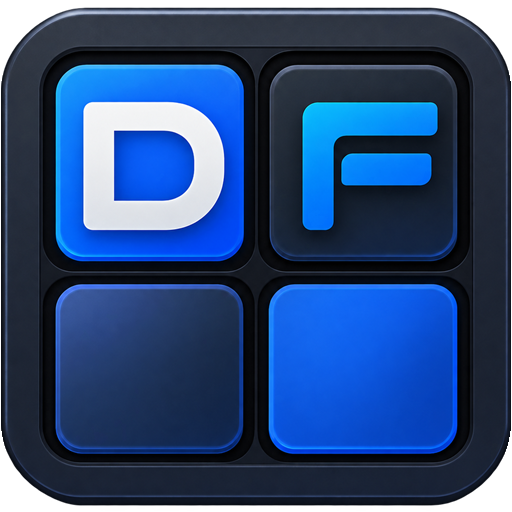
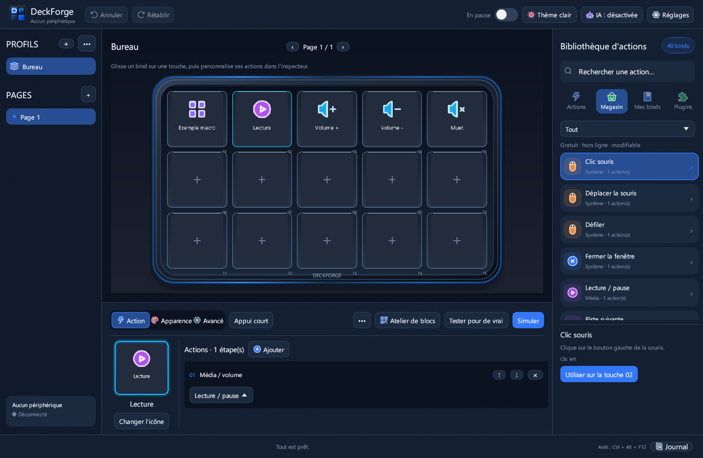

# DeckForge

<div align="center">
  <br>
  <h3>Le centre de contrôle macro & streamdeck open-source, ultra-rapide et sécurisé pour Windows</h3>

  [](LICENSE)
  [](https://www.rust-lang.org/)
  []()
  [](https://github.com/HatiFlash/DeckForge/releases/tag/v0.7.0)
</div>

---

**DeckForge** est une application indépendante écrite en **Rust** (egui + wgpu DirectX 12 / Vulkan) conçue pour piloter vos claviers macro physiques avec un niveau de performance, de personnalisation et de sécurité inégalé. Fini les logiciels propriétaires lourds et fermés : DeckForge vous offre une réactivité instantanée, un atelier d'automatisation visuel complet sans dépendance externe, un connecteur IA (MCP) natif et la compatibilité avec l'écosystème de plugins Elgato Stream Deck.



---

## ✨ Fonctionnalités phares

### 🎮 Périphériques pris en charge
- **FIFINE AmpliGame D6 (15 touches LCD)** : Prise en charge matérielle complète, retour visuel dynamique sur chaque touche, réglage de la luminosité et mise en veille automatique.
- **Elgato Stream Deck (Testé & Compatible)** : Prise en charge native via le pilote HID direct pour les claviers Stream Deck physiques, avec synchronisation des touches et retour d'état en direct.
- **Contrôleurs compatibles HID** : Architecture modulaire extensible pour d'autres modèles du marché (Mirabox, AJAZZ / Stream Dock).

### ⚡ Atelier de blocs natif (Sans scripts ni dépendance)
Composez des automatisations puissantes en glissant-déposant des blocs directement dans l'interface, sans avoir besoin d'AutoHotkey :


- **Gestion audio intelligente** : Ajustez le volume de l'application au premier plan ou d'un exécutable précis sans jamais altérer le volume général de Windows. Basculez d'un clic entre casque et enceintes avec mise à jour immédiate de l'icône et du titre sur la touche.
- **Intégrations streaming & multimédia** : Contrôle natif d'OBS Studio (changement de scènes, enregistrement, stream, replay buffer, bascule des sources et micro), Discord, soundboard intégrée et commandes multimédias.
- **Logique conditionnelle avancée** : Blocs *Si... alors... sinon* basés sur 14 conditions en temps réel (fenêtre active, son en cours de lecture, micro muet, casque branché, variables globales) et bloc *Attendre que...*.
- **Contrôle système & fenêtres** : Déplacement de fenêtres vers un second écran, ancrage, premier plan forcé, simulation fluide de frappes clavier (maintien de touche, anti-rebond) et déplacements relatifs de souris.
- **Variables & Déclencheurs automatiques** : Déclenchez des actions lors de l'ouverture/fermeture d'un jeu ou logiciel, à heure fixe ou sur événement audio. Insérez des variables dynamiques `{heure}`, `{date}`, `{presse_papiers}` dans vos messages et requêtes.

### 🧩 Écosystème de Plugins Stream Deck & OpenAction
Importez directement vos archives de plugins préférées (`.streamDeckPlugin` / `.sdPlugin`) depuis le magasin intégré :


- **Multi-moteurs d'exécution** : Prise en charge des exécutables natifs C++/Rust/C#, des scripts Node.js (`@elgato/streamdeck` v2) et des plugins avec moteur backend HTML (`Runtime::Html`).
- **Property Inspectors HTML sécurisés** : Les fenêtres de réglages s'exécutent dans un sous-processus WebView2 isolé (`--isolated-inspector`) avec proxy loopback strict interdisant toute fuite réseau non autorisée (anti-TOCTOU, pas d'accès internet sauvage).
- **Composants sdpi intégrés hors-ligne** : Support natif des `sdpi-components` officiels v3 et v4 (embarqués localement) et BarRaider EasyPI avec injection automatique du thème sombre.
- **Persistance bidirectionnelle** : Synchronisation temps réel des réglages (`setSettings`, `setGlobalSettings`) entre l'interface et le matériel.

<div align="center">

| Property Inspector Elgato (sdpi-components) | Réglages VolumeController (BarRaider) |
| :---: | :---: |
|  |  |
| **SignalRGB (EasyPI + thème DeckForge)** | **Compteur Elgato (Node.js)** |
|  |  |

</div>

### 🤖 Intégration IA Plug-and-Play (Protocole MCP)
DeckForge embarque un serveur MCP (**Model Context Protocol**) natif pour collaborer avec vos assistants d'IA sans aucune ligne de code ni modification de fichier JSON :
- Connectez d'un clic **Claude Desktop**, **Claude Code**, **Codex CLI** ou **Cursor** via le bouton **IA** dans la barre d'outils.
- L'IA peut explorer vos profils, vous suggérer des agencements de touches optimisés pour vos jeux ou outils de création, et générer des macros complètes.
- **Contrôle humain préservé** : chaque proposition d'action formulée par l'IA apparaît en prévisualisation et attend votre validation explicite avant d'être appliquée sur votre profil.

### 🎨 Interface Studio & Rendu Direct wgpu
- **Rendu matériel wgpu (DirectX 12 / Vulkan)** : Finis les scintillements et artefacts d'affichage rencontrés sur d'autres outils egui ; l'interface est parfaitement fluide à 60+ FPS.
- **Pavé dynamique réactif** : La grille de touches s'adapte automatiquement à la résolution de votre écran et aux redimensionnements de la fenêtre.
- **Galerie multimédia riche** : Prise en charge complète des images PNG, JPEG, SVG transparents, mais aussi des GIF animés et des vidéos courtes lues en boucle directement sur les touches LCD.
- **Gestion multi-profils et dossiers** : Créez des profils dédiés par application avec basculement automatique au lancement de vos jeux ou logiciels créatifs, et organisez vos touches en sous-dossiers infinis.

---

## 🚀 Prise en main rapide

1. Téléchargez la dernière version Windows (`DeckForge-v0.7.0-Windows.zip`) depuis la [page des Releases](https://github.com/HatiFlash/DeckForge/releases).
2. Extrayez l'archive dans le dossier de votre choix et lancez `deckforge.exe`.
3. *Note importante pour les possesseurs du FIFINE D6 :* veillez à fermer le logiciel officiel FIFINE afin de libérer l'accès USB exclusif pour DeckForge.
4. Glissez simplement une action depuis la bibliothèque vers la touche souhaitée, ou ouvrez l'**Atelier de blocs** pour composer votre première macro !

---

## 🛠️ Compilation & Développement

DeckForge est développé en Rust et se compile en mode verrouillé (`--locked`) :

```bash
# Cloner le dépôt
git clone https://github.com/HatiFlash/DeckForge.git
cd DeckForge

# Compiler en mode Release
cargo build --release --locked

# Lancer la suite complète de tests (317+ tests unitaires et d'intégration)
cargo test --locked
```

---

## 📄 Licence & Mentions

Ce projet est distribué sous [licence MIT](LICENSE). Aucun binaire tiers propriétaire, archive protégée ou pack de ressources fermé n'est inclus dans le dépôt de code source.
Pour les notices relatives aux dépendances open-source et bibliothèques embarquées, consultez [THIRD-PARTY-NOTICES.txt](THIRD-PARTY-NOTICES.txt).
